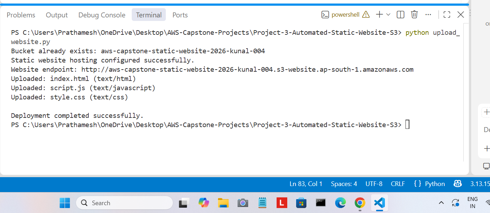
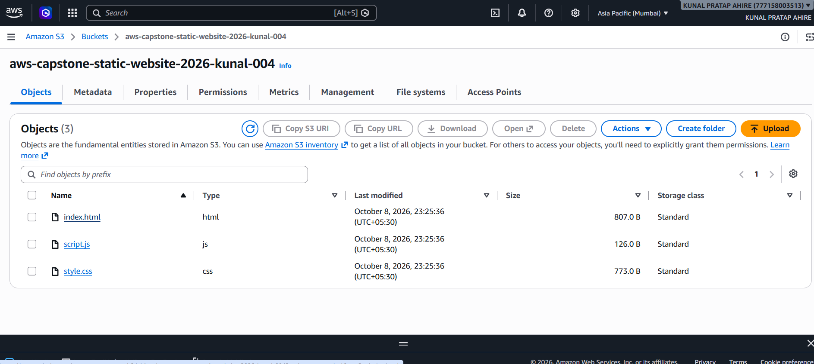
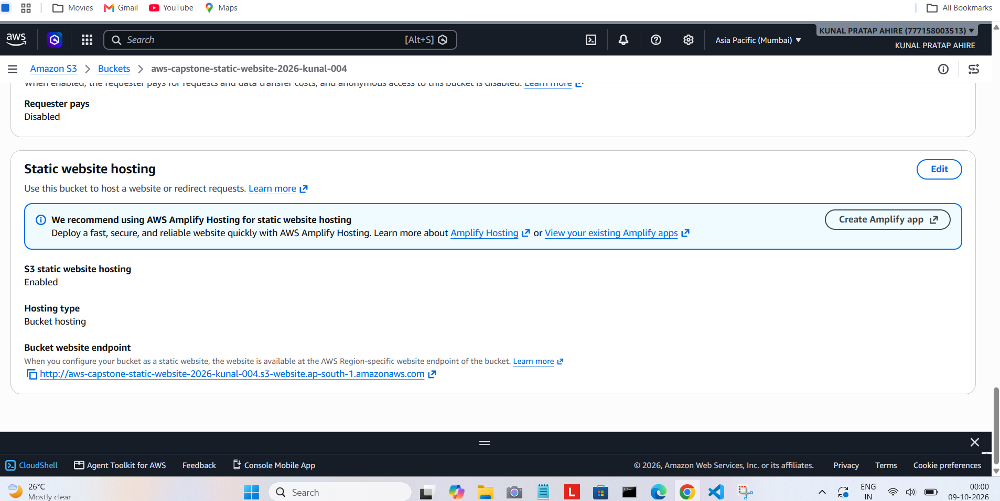
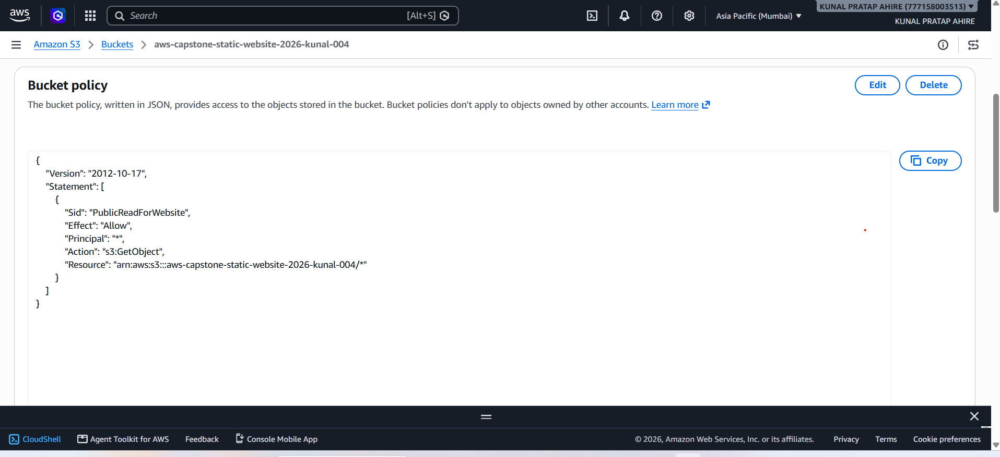
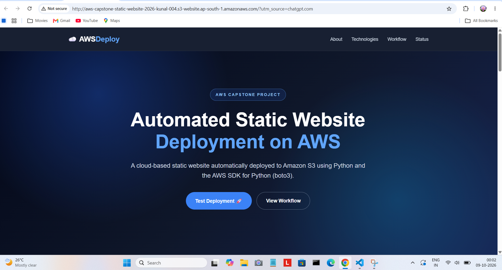
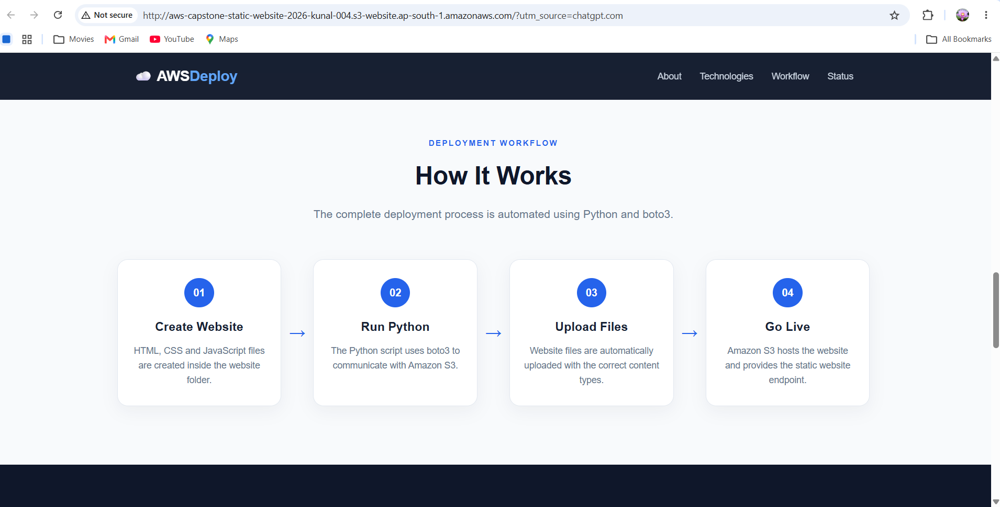
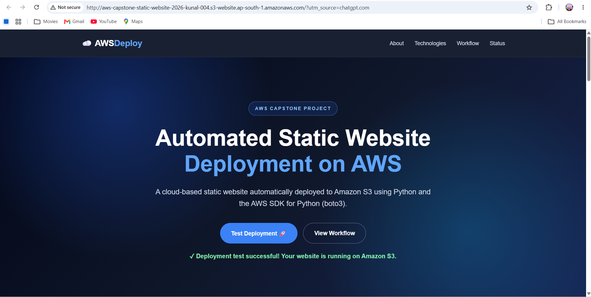

# Automated Static Website Hosting Using AWS SDK

## Project Overview

This project demonstrates how to automatically deploy a static HTML, CSS, and JavaScript website to Amazon S3 using Python and the AWS SDK for Python (boto3).

Instead of manually uploading website files to Amazon S3, the Python automation script creates or identifies the S3 bucket, configures static website hosting, detects the correct content type, and uploads the complete website folder automatically.

## Objective

The main objectives of this project are:

* Deploy a static website to Amazon S3 using Python and boto3.
* Automate website file uploads.
* Configure Amazon S3 static website hosting.
* Upload HTML, CSS, and JavaScript files with appropriate content types.
* Display the deployed website endpoint.
* Demonstrate an automated cloud deployment workflow.

## AWS Services and Technologies Used

### AWS Services

* Amazon S3

### Technologies

* Python
* boto3
* HTML
* CSS
* JavaScript

## Architecture

```text
HTML / CSS / JavaScript
          |
          v
     Python + boto3
          |
          v
      Amazon S3
          |
          v
 Static Website Hosting
          |
          v
      Web Browser
```

## Project Structure

```text
Project-3-Automated-Static-Website-S3/
│
├── upload_website.py
│
├── website/
│   ├── index.html
│   ├── style.css
│   └── script.js
│
└── screenshots/
    ├── 01-python-deployment.png
    ├── 02-s3-bucket.png
    ├── 03-static-hosting.png
    ├── 04-public-access-policy.png
    ├── 05-live-website.png
    ├── 06-live-website-workflow.png
    └── 07-javascript-test.png
```

## Implementation

### Step 1: Create the Website

A static website was created using:

* HTML for structure
* CSS for styling
* JavaScript for interaction

The website contains project information, technologies, deployment workflow, architecture, and deployment status.

### Step 2: Configure Python and boto3

Python was used to automate the deployment process.

boto3 was installed and tested successfully.

```bash
python --version
```

```bash
python -c "import boto3; print(boto3.__version__)"
```

### Step 3: Create or Identify the S3 Bucket

The Python script checks whether the required S3 bucket already exists.

If the bucket does not exist, the script creates it in the `ap-south-1` region.

Bucket name:

```text
aws-capstone-static-website-2026-kunal-004
```

### Step 4: Configure Static Website Hosting

The Python script configures Amazon S3 static website hosting with:

```text
Index Document: index.html
```

The deployment script also displays the S3 website endpoint.

### Step 5: Upload Website Files

The script automatically scans the website folder and uploads all files.

It also detects the appropriate content type.

Examples:

```text
index.html → text/html
style.css  → text/css
script.js  → text/javascript
```

### Step 6: Deploy the Website

Run the following command from the project root:

```bash
python upload_website.py
```

Example successful output:

```text
Bucket already exists: aws-capstone-static-website-2026-kunal-004
Static website hosting configured successfully.
Website endpoint: http://aws-capstone-static-website-2026-kunal-004.s3-website.ap-south-1.amazonaws.com
Uploaded: index.html (text/html)
Uploaded: script.js (text/javascript)
Uploaded: style.css (text/css)

Deployment completed successfully.
```

## Deployment Workflow

```text
1. Create Website
       ↓
2. Run Python Script
       ↓
3. boto3 Connects to Amazon S3
       ↓
4. Configure Static Website Hosting
       ↓
5. Upload Website Files
       ↓
6. S3 Hosts Website
       ↓
7. Open Website in Browser
```

## Website Features

The deployed website includes:

* Responsive navigation
* Hero section
* Project overview
* Technology section
* Deployment workflow
* Cloud architecture section
* Deployment status
* Interactive JavaScript deployment test
* Responsive design for smaller screens

## Screenshots

### 1. Python Deployment



### 2. S3 Bucket



### 3. Static Website Hosting



### 4. Public Access Policy



### 5. Live Website



### 6. Website Workflow



### 7. JavaScript Test



## Deployment and Run Instructions

### Prerequisites

Make sure the following are installed:

* Python
* boto3
* AWS CLI or configured AWS credentials

### Install boto3

```bash
pip install boto3
```

### Configure AWS Credentials

Configure AWS credentials securely using the AWS CLI or another supported AWS credential provider.

Do not place AWS access keys or secret keys inside the project files.

### Run the Deployment

Navigate to the project directory:

```bash
cd Project-3-Automated-Static-Website-S3
```

Run:

```bash
python upload_website.py
```

After successful execution, open the displayed S3 website endpoint in a web browser.

## Security Practices

* AWS credentials and secret keys were not stored in the source code.
* No credentials were uploaded to GitHub.
* The S3 bucket policy was configured only for website object access required by the static website.
* AWS credentials should be managed using secure AWS credential mechanisms.
* Sensitive information should never be committed to GitHub.

## Key Learnings

Through this project, I learned:

* How Amazon S3 static website hosting works.
* How to use boto3 with Amazon S3.
* How to automate cloud deployments using Python.
* How to upload multiple files programmatically.
* How to assign appropriate content types to uploaded files.
* How to configure static website hosting.
* How to deploy and test a website on AWS.
* How automation can reduce manual cloud deployment steps.

## Project Result

The static website was successfully deployed to Amazon S3 using Python and boto3.

The deployment process was automated, and the website was successfully accessed through the Amazon S3 static website endpoint.

## Conclusion

This project demonstrates a simple and practical approach to cloud deployment automation using Python, boto3, and Amazon S3. It replaces manual website uploads with an automated deployment script and provides a working example of AWS-based static website hosting.

## AWS Region

```text
ap-south-1
```

## Project Type

```text
AWS Capstone Project
Automated Static Website Hosting Using AWS SDK
```
Get-ChildItem -Recurse -File